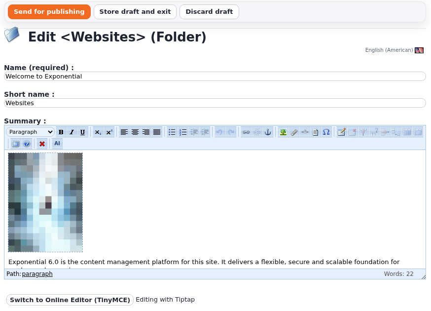

# exp_oe_tiptap

A [Tiptap](https://tiptap.dev/product/editor) based online editor for ezxmltext fields in Exponential 6, as an
engine of the Online Editor (ezoe), next to TinyMCE 3 and 8. Editors switch between the engines on the fly, on the
same content, without losing what they typed. Optional AI commands (improve, shorten, extend, fix spelling,
translate, summarise, continue) call a provider of your choice from the server; they are off by default.

**Status: 0.1.1 (compare-ready).** Not for production yet: ezoe's TinyMCE stays the default editor until the
round-trip test suite is green on your content. See [doc/plan.md](doc/plan.md) for the phases.

## How it works, in one paragraph

Content stays ezxmltext. ezoe turns ezxml into its editor HTML and parses that HTML back; this extension keeps
both halves exactly as they are and only swaps the thing in the middle: TinyMCE or Tiptap. Tiptap's schema
mirrors ezoe's HTML dialect one to one, so what one editor writes the other reads, and the stored XML is the
same. Tiptap is registered in ezoe's editor engine registry (`ezoe.ini [EditorSettings] Engines[tiptap]`), so the
choice of editor is ezoe's one choice: the page `ezoe/engine`, ezoe's "Switch to the editor ..." buttons below
the field, `EditorEngine` per siteaccess. Details: [doc/architecture.md](doc/architecture.md).

## Screenshot



A text field edited with Tiptap in the admin: the toolbar follows ezoe's layout settings, the AI button sits at its
end when the AI commands are enabled, and ezoe's buttons "Switch to the editor TinyMCE ..." below the field go back
to TinyMCE with the text kept.

## Quick start

1. ezoe and ezjscore active, and exp_oe_tiptap added to `ActiveExtensions` (any place: it declares that it extends ezoe):
   ```ini
   [ExtensionSettings]
   ActiveExtensions[]=ezjscore
   ActiveExtensions[]=ezoe
   ActiveExtensions[]=exp_oe_tiptap
   ```
2. Regenerate autoloads and clear caches:
   ```bash
   php bin/php/ezpgenerateautoloads.php -e
   php bin/php/ezcache.php --clear-tag=ini --clear-tag=template --allow-root-user
   ```
3. Open `/ezoe/engine` in the admin: Tiptap is listed with its version and status next to TinyMCE. Choose it, or
   edit an article and press "Switch to the editor Tiptap" below the text field. The draft is stored, the form
   comes back with Tiptap; the buttons there switch back.
4. Upgrading from 0.1.0: run `php extension/exp_oe_tiptap/bin/php/migrate_editor_preference.php -s <admin siteaccess>`
   once (optional, see [INSTALL.md](INSTALL.md#upgrading-from-010)).

Full instructions: [INSTALL.md](INSTALL.md).

## Documentation

| | |
| --- | --- |
| [INSTALL.md](INSTALL.md) | requirements, activation, settings, building, AI, verifying |
| [doc/usage.md](doc/usage.md) | for editors: choosing and switching the editor, what is the same and what differs |
| [doc/configuration.md](doc/configuration.md) | every setting |
| [doc/architecture.md](doc/architecture.md) | how the parts fit |
| [doc/content-mapping.md](doc/content-mapping.md) | the ezoe HTML dialect and its Tiptap schema |
| [doc/ai-hooks.md](doc/ai-hooks.md) | the AI commands, providers, security |
| [doc/extending.md](doc/extending.md) | custom tags, toolbar buttons, AI commands |
| [doc/maintenance.md](doc/maintenance.md) | upgrading Tiptap, rebuilding, tests, troubleshooting |
| [doc/plan.md](doc/plan.md) | plan, phases, risks, open decisions |
| [doc/changelogs/](doc/changelogs/0.1.4.md) | what changed in each release |

## Licence

GNU General Public License v2.0 (or any later version). Copyright (C) 1998 - 2026 Exponential Foundation and 7x. All rights reserved.

Includes Tiptap and ProseMirror (MIT License) in the built bundle. Tiptap's paid Pro extensions are not used.
